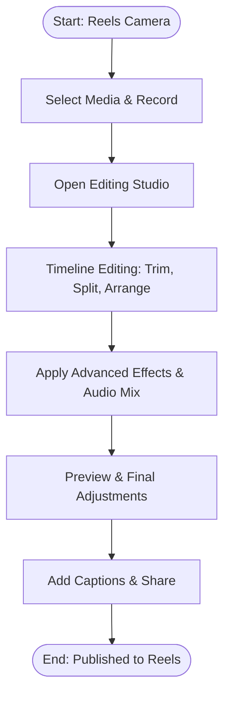
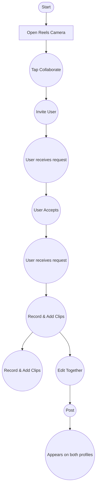

# Product Case Studies by Lakshay Jain

**Contents**

1. [Domino's New Packaging: A Strategic Redesign](#1-dominos-new-packaging-a-strategic-redesign)
2. [Improving the Reels Experience on Instagram](#2-improving-the-reels-experience-on-instagram)
3. [UI/UX Case Study: PNB Website Redesign](#3-uiux-case-study-pnb-website-redesign)
4. [Improving Discord for New Users](#4-improving-discord-for-new-users)

---

## Conventions used in this file

- `` lines are **image placeholders**. Replace the path with the real asset. Each has alt text and a note on where it sits in the flow.
- `> **Stat:**` lines are **big-number callouts** (good candidates for stat-card components).
- `> **Insight:**` lines are **highlighted callouts / key insights**.
- Chart data is given in **tables**. Where the PDF does not print numbers, values are **estimated from the visual** and marked *(est.)*. Replace them with real data if you have it.
- Text is kept as in the PDF. Obvious typos are noted in `<!-- comments -->`.

---
---

# 1. Domino's New Packaging: A Strategic Redesign

```yaml
title: "Domino's New Packaging: A Strategic Redesign"
subtitle: "A Strategic Redesign"
author: Lakshay Jain
type: Product Teardown
brand_colors: ["#006491 (blue)", "#E31837 (red)"]
```

### Hero

**Domino's New Packaging**
*A Strategic Redesign*

Created by **Lakshay Jain**

- Badge: **Sustainability: Eco-Friendly**
- CTA button: *Start Presentation →*
- Site nav (from mockup): Menu · Coupons · Case Study · **PRODUCT TEARDOWN** (button)


*Hero image, right of the title.*

---

## The Problem Landscape

**Identifying the Friction: Why the Old Box Failed**

*Breadcrumb: Case Study › Domino's Packaging › Problem Phase*

| Problem | Tag | Description | Metric label | Value | Status chip |
|---|---|---|---|---|---|
| **Thermodynamics** | CRITICAL | Standard corrugated cardboard lacks insulation, causing pizza to lose optimal serving temperature rapidly during delivery. | Heat loss (15m) | **40%** | Poor Retention |
| **Sustainability** | HIGH WASTE | Grease saturation allows oil to seep into fibers, rendering a significant portion of legacy boxes unrecyclable in municipal facilities. | Unrecyclable volume | **30%** | Environmental Risk |
| **Structural Integrity** | FRICTION | Weak sidewalls limit stacking capability during bulk delivery periods, often leading to crushed toppings and poor presentation. | Safe stack limit | **3 Boxes** | Low Stability |

> **Insight: The Core Insight**
> The market demanded a solution that strictly balances **thermal efficiency** with **eco-accountability**.

---

## Strategic Rationale: Why the Change?

Deconstructing the strategic pivot to eco-friendly, stackable packaging designed for the modern delivery ecosystem. Our new initiative is driven by four key business objectives aimed at long-term growth.

> **Stat: Projected ROI: +24%** (FY 2025-2026)

### Four business objectives

| Objective | Badge | Description |
|---|---|---|
| **Sustainability First** | −30% PLASTIC | Shifting to 100% recycled materials to reduce carbon footprint significantly. |
| **Brand Modernization** | PREMIUM | Elevating the brand perception from 'fast food' to a 'premium dining experience'. |
| **Heat Retention** | +15% HEAT | New corrugated structure retains heat 15% longer during last-mile delivery. |
| **Stackability** | 2X EFFICIENCY | Optimized box geometry fits perfectly in standard courier bags, doubling capacity. |

### Chart A: Carbon Footprint (line / area chart)

> **Stat: −12.5%** (−2% YoY): *Projected reduction FY 2023-2025*

No axis values are printed. The curve rises from Q1 to a first peak near Q2, dips at Q3, then climbs to its highest point just before Q4 and eases slightly at the end.

| Quarter | Relative index *(est.)* |
|---|---|
| Q1 | 30 |
| Q2 | 55 |
| Q3 | 38 |
| Q4 (peak, just before the label) | 85 |
| Q4 (end of line) | 72 |

<!-- The x-axis label for Q4 is printed as "04" in the PDF. Treated as Q4. -->

### Chart B: Customer Satisfaction (NPS), bar chart

> **Stat: +8 Pts** (+15% YoY): *Pre vs Post Launch Analysis*

| Group | Bar height relative to New Box *(est.)* |
|---|---|
| Old Box | ~67% |
| New Box | 100% |

(No absolute NPS values are printed. Only the +8 pt difference is stated.)

---

## The Unboxing Experience

**Packaging Redesign Strategy**


*Left column image.*

> **Strategic Context**
> A shift from chaotic graphics to a clean, bi-color modular design that aligns with the 'Tech-First' pizza company identity. This approach prioritizes visual clarity and brand consistency across markets.

| Feature | Detail |
|---|---|
| **Insulation** | +15% Heat Retention |
| **Sustainable** | 100% Recyclable |
| **Modular** | Clean Aesthetic |

<!-- The box image reads "Domino,s Pizza" (comma instead of apostrophe) and "Flavoutful TOPRINGS" – typos in the source image, not the text. -->

---

## User Persona 01: The Conscious Craver

*Analyzing the typical interaction with sustainable packaging*

Tags: `TECH SAVVY` · `HIGH FREQUENCY`


### Aman Kapoor
**Junior Developer, 26**

Aman is a junior developer living in a metro area. He orders late-night food roughly 3x a week to fuel coding sessions. He values speed and hot food but is increasingly aware of his carbon footprint.

### Demographics

| Attribute | Value |
|---|---|
| Location | Seattle (Urban) |
| Tech Savvy | Early Adopter |
| Income | Middle-High |

### Ordering Habits (progress bars)

| Habit | Label | Bar fill *(est.)* |
|---|---|---|
| Frequency (3x/week) | High | ~85% |
| Late night | Very Often | ~92% |
| Basket size | $35.00 | ~60% |

### Key Expectations
- ✅ **Temperature:** Food must be piping hot.
- *(Further expectations are cut off in the PDF page.)*

### Eco-Concerns
- **Recyclability Importance:** 4 of 5 segments filled (High)
- *(Further eco-concern items are cut off in the PDF page.)*

---

## From Concept to Counter: The Rollout Strategy

*Breadcrumb: Strategy › Execution › Rollout Phase*
Status badge: **Phase 2 Active**

A phased approach to implementing new sustainable packaging across 1,500+ franchise locations.

### Implementation Roadmap

| Phase | Timing | Status | Description | Tags |
|---|---|---|---|---|
| **Phase 1: Pilot Program** | Q1 2024 | ✅ COMPLETED | Beta testing deployed in 50 select stores across Tier-1 Metro cities. Focused on customer feedback regarding heat retention. | 50 Stores · 98% Positive Feedback |
| **Phase 2: Supply Chain Optimization** | Q2 2024 | 🔴 IN PROGRESS | Onboarding sustainable material vendors and retraining kitchen staff on new folding techniques. Logistics restructuring. | Staff Training · Vendor Onboarding |
| **Phase 3: Nationwide Launch** | Q3 2024 | UPCOMING | Full rollout to all 1,500+ locations accompanied by a major "Unboxing" marketing campaign. | none |


**Expansion Zones**: *Targeting Tier-2 cities in Phase 3*

### Operational Key Results

| Card | Category | Value | Description |
|---|---|---|---|
| Cost | COST | **15%** | Reduction in material costs |
| Reach | REACH | **10M+** | Projected impressions |
| Sustainability Target | ON TRACK | **100%** | Plastic-free packaging by 2025 (progress bar ~85% filled) |

---

## Packaging Success Metrics

`CASE STUDY` · Domino's Packaging Redesign · *Q3 PERFORMANCE REPORT*

### Delivery Experience

> **Stat: 4.8 ★** (4.5 stars shown) | **+14% vs old packaging**

Rating distribution:

| Rating | Share |
|---|---|
| 5 | 75% |
| 4 | 15% |
| 3 | 10% |

### Waste Reduction: *Cardboard usage per unit*

> **Stat: −22%** | tag: Eco-Impact

Bar chart by quarter:

| Quarter | Value |
|---|---|
| Q1 | not labeled (grey bar) |
| Q2 | not labeled (grey bar) |
| Q3 | not labeled (grey bar) |
| **Q4** | **78%** (highlighted red bar) |

### Heat Retention: *Temp after 20m delivery*

> **Stat: +15 min** | Hotter for longer | **OPTIMAL TEMP**

### Brand Sentiment: *Customer feedback analysis*

Tags: `Innovative` · `Eco-friendly` *(more tags cut off in the PDF page)*

---

## Conclusion: The Final Slice: Verdict

*A teardown of the new sustainable aesthetic and its measurable impact on brand perception.*

### Objectives
Reduce material waste by 15% while improving heat retention mechanisms. The goal was to modernize the brand voice without alienating the core customer base.

### Design Execution
A minimalist visual language utilizing 2-color printing to lower ink costs and enhance recyclability. The "Zomato-esque" dark mode aesthetic appeals to digital-native users.

| Metric | Value | Tag |
|---|---|---|
| Waste | **−15%** | Material Usage |
| Engagement | **+20%** | Social Shares |
| Heat Retention | **High** | Performance |


**The New Standard ✔**: *Dark mode aesthetic with vibrant accents optimized for social sharing.*

---

## Thank You!

**CASE STUDY COMPLETE**
Domino's Packaging Teardown
We hope you enjoyed this deep dive into the design decisions behind our new eco-friendly boxes.


Footer: Domino's · Case Study · dominos.com · 👍 · share

---
---

# 2. Improving the Reels Experience on Instagram

```yaml
title: "Improving the Reels Experience on Instagram"
author: Lakshay Jain
type: Product Teardown
```

*Created by Lakshay Jain*

---

## Product Overview

### Description

Launched by Instagram in 2020, Reels is a short-form video feature designed to compete with platforms like TikTok. It allows users to create and discover short, entertaining videos up to 90 seconds long.

Reels is integrated directly into the Instagram app, leveraging its massive existing user base. It offers a suite of creative tools including audio, AR effects, and editing features.

The feature focuses on content creation, discovery through a dedicated feed, and monetization for creators, making it a critical component of Instagram's engagement and growth strategy.

### Competitors

TikTok · YouTube Shorts · Snapchat Spotlight · Triller

### Stats

| Stat | Value |
|---|---|
| Monthly Active Users | **2B+** |
| Daily Plays | **200B+** |
| Market Share in US | **45%** |
| Total Time on Insta | **50%** |
| Gen Z Watch Weekly | **91%** |
| Countries | **140+** |

---

## Product Overview: Business Model

**Business Model: Advertisement & Creator Economy**
Monetization primarily through targeted video ads in the Reels feed and empowering creators with tools for brand partnerships and direct monetization.


| Users of Reels | Key Features | Additional Revenue |
|---|---|---|
| Content Creators | Advanced Editing Tools | Creator Subscriptions |
| Viewers & Followers | Extensive Audio Library | Shopping Tags & E-commerce |
| Brands & Businesses | AR Effects and Filters | Gifting and Tipping Features |
| Influencers & Marketers | Remix and Duet Features | Branded Content & Partnerships |
| Artists & Musicians | Templates for Easy Creation | Affiliate Marketing Links |
| Educators & Niche Experts | Seamless Sharing to Feed/Stories | Creator Marketplace |
| none | Interactive Stickers (Polls, Q&A) | none |

---

## User Persona


### Maya Singh
22 year old Female · University Student in Mumbai

### Goals

- **Creative Expression & Community:** Maya's primary goal is to use Reels as a platform to share her passion for sustainable fashion and connect with a like-minded community.
- **Entertainment and Trend Discovery:** She uses Reels for daily entertainment, to discover new music, and to stay updated on viral trends that she can adapt for her own content.
- **Skill Development:** She aims to improve her video editing and storytelling skills. She looks for new features, effects, and tutorials to enhance the quality of her Reels.
- **Meaningful Engagement:** Beyond likes, she seeks genuine conversations and feedback in her comments section to build a loyal and interactive following.
- **Inspiration & Learning:** She follows other creators to draw inspiration for her studies, hobbies, and personal style, treating Reels as a visual discovery engine.

### Concerns

- **Content Discovery Fatigue:** Maya struggles with the repetitive nature of the algorithm, often seeing the same trends and sounds. She wants more variety and content that truly aligns with her niche interests.
- **Pressure to Perform:** As a creator, she feels the pressure to constantly produce high-engagement content. The unpredictable nature of the algorithm can be discouraging when videos she's proud of don't perform well.
- **Negative Social Comparison:** Endless scrolling through highly curated and successful-looking content sometimes leads to feelings of inadequacy and impacts her mental well-being, making her question her own progress and creativity.

---

## Problem Identification

The problem we set out to solve is to **improve Reels content discovery** to increase user engagement by focusing on watch time and creator follows.

This has the following anchors:

- ▶️ Watch time
- 👤➕ Creator follows
- 🔗 Share frequency

> **Insight:** Thus to influence any of these metrics we have to make sure our users discover more relevant content or connect with more creators.

```text
Engagement = Watch Time x Creator Follows x No. of Sessions
```

### Stakeholders in this problem

Viewers · Creators · Advertisers · Instagram

---

## User Journey Map: Reels User Journey

| | Discovery | Consumption | Consideration | Creation | Sharing |
|---|---|---|---|---|---|
| **Stage** | User opens Instagram | User starts watching Reels | User gets an idea | User records & edits a Reel | User posts the Reel |
| **Goals** | To be entertained | Find interesting content | To create something similar | To create an engaging Reel | To get views and likes |
| **Steps** *(image per stage)* |  |  |  |  |  |
| **Touchpoints** | Opens the app | Navigates to Reels tab | Saves audio / effect | Uses creation tools | Writes caption, clicks share |
| **Emotions** | 🙂 | 😄 | 🤩 | 🤔 | 🤞 |
| **Pain points** | Irrelevant content | Repetitive trends | Hard to find trending audio | Complex editing tools | Anxiety about performance |

---

## Reels Prioritization (RICE)

| Problem / Opportunity | Reach | Impact | Confidence | Effort | Score |
|---|---|---|---|---|---|
| Lack of clear categorization for Reels content (e.g., no tags or topic filters) | 8 | 8 | 75% | 5 | **90** |
| Inefficient discovery of niche content creators; algorithmic suggestions are too broad | 9 | 7 | 80% | 6 | **84** |
| Limited creative tools compared to competitors (e.g., advanced editing, templates) | 7 | 6 | 90% | 4 | **75** |
| Difficulty in tracking engagement metrics for individual Reels performance over time | 5 | 8 | 85% | 7 | **60** |
| Inconsistent video quality and playback issues across different devices | 6 | 5 | 70% | 8 | **52** |

Based on the RICE framework (Reach x Impact x Confidence / Effort), the problems with the highest potential scores of 90 and 84 have been identified for immediate prioritization to significantly improve the Instagram Reels experience and creator satisfaction.

<!-- Note: the printed scores don't match the stated formula. e.g. 8 x 8 x 0.75 / 5 = 9.6, so scores appear to be scaled or rounded by the author. Kept as printed. -->

---

## Solution 1: Introducing Instagram Reels: Enhanced Editing Tools

The goal is to empower creators with pro-level video editing capabilities directly within the Reels camera, reducing friction and increasing content quality.

It should enable users to effortlessly trim, splice, add advanced effects, and manage multi-track audio before publishing, streamlining the creation process.

### User Flow: Advanced Editing



### Screens

| Screen | Description |
|---|---|
|  **Reels Camera & Entry** | Entry point from the Reels camera to access the dedicated Editing Studio. |
|  **Editing Studio Interface** | Intuitive timeline with precise trimming, multi-track audio, and advanced effect overlays. |
|  **Preview & Share** | Final preview with options to add captions and share directly to the Reels feed. |

*Next: Impact Analysis →*

---

## Solution 2: Introducing Collaborative Reels

The goal is to foster community and increase engagement by allowing multiple users to contribute clips to a single, shared Reel. This feature addresses the need for more interactive and co-creative content formats. Users can invite friends to collaborate, combine their clips, and post the final Reel to both their profiles, expanding reach and encouraging participation.

### User flow



<!-- The original flowchart has two parallel "Record & Add Clips" branches and two "receives request" nodes. Re-draw from the screenshot if exact topology matters. -->

| Screen | Caption |
|---|---|
|  | Left: User invites a collaborator during Reel creation. |
|  | Right: The final collaborative Reel appears on both profiles, showing shared authorship. |

---

## Reels Success Metrics

*Time-frame = 1 quarter. An up-arrow icon implies metric magnitude.*

### User-Centric

| Metric | Measures | Sub-metric |
|---|---|---|
| **Increased Engagement** | Likes, comments, & shares per Reel | Clicks on 'Share' CTA |
| **Higher Content Creation** | Number of Reels created by users | Reel creation attempts |
| **Longer Viewing Time** | Average time spent watching Reels | Session duration in Reels tab |

### Product-Centric

| Metric | Measures | Sub-metric |
|---|---|---|
| **Growth in DAU** | Daily Active Users engaging with Reels | Frequency of app opens |
| **Increase in Ad Revenue** | Revenue generated from Reels ads | Number of ad impressions |

---

## Conclusion

We aimed to understand and improve the Instagram Reels experience to drive higher engagement and user retention, focusing on content creation and discovery. After a thorough product teardown, we identified critical areas for growth.

**Problems Identified:**
1. High friction for new creators to produce high-quality short-form video content.
2. Limited discovery of original, niche content outside of viral trends.
3. Lack of clear monetization pathways for emerging Reels creators.

**Solutions:**
1. Enhanced Reels Creation Suite with AI-powered editing tools and templates.
2. Integrated 'Creators Fund' and better algorithmic matching for niche content discovery.

---
---

# 3. UI/UX Case Study: PNB Website Redesign

```yaml
title: "UI/UX Case Study: PNB Website Redesign"
year: 2025
authors: ["Himani", "Lakshay"]
type: UI/UX Redesign
design_system:
  font: Outfit
  colors: ["#AF2A30", "#FFF1D3", "#C00000", "#FDBD30", "#FFA7A8"]
```


# UI/UX CASE STUDY
**2025**
*Himani & Lakshay*

---

## Problem Statement

PNB's banking website is difficult to navigate, with complex menus and a cluttered homepage that frustrate users trying to complete tasks like fund transfers, bill payments, and account management. The lack of personalization and outdated design further complicates the user experience, especially for mobile users. These issues lead to inefficiency, user frustration, and a negative impact on customer retention.

This case study seeks to improve the website's usability by addressing navigation, information overload, and visual design, ultimately enhancing the overall user experience.

### Key problem callouts

- Lack of clear navigation paths hinder users from quickly finding the services they need.
- The homepage is cluttered with excessive information, making it difficult for users to focus on their primary goals.
- The site fails to provide users with personalized content or dashboard views, which could help them quickly access their most used services.
- The website's design and typography are outdated, affecting readability and overall aesthetics.

---

## Designing Process

| Step | Phase | Sub-title | Description |
|---|---|---|---|
| **01** | **DISCOVERY** | Primary & Secondary Research | In this step, we conducted Primary Research and secondary Research to understand the User perspective on PNB current website. What are the key challenges faced by them by conducting surveys and interviews, allowing us to identify key problem statements and articulate the challenges faced by users. |
| **02** | **IDEATION** | HMW & Solutions | In this step, we defined solutions that provided an overarching overview, emphasizing improvements in two specific user flows: the visibility of important features and the Redesign UI with consistent and softer color palettes, utilizing the How Might We (HMW) method. This targeted approach aims to enhance usability and user experience within these key interactions. |
| **03** | **IMPLEMENTATION** | Wireframe & UI | In this step, we established the visual direction and utilized this guide to create wireframes and user interfaces that align with the design system. This approach culminated in the development of a functional prototype, ensuring a cohesive and user centered design that effectively addresses the identified challenges. |

---

## Typography

**Outfit**: *Classic and Geometric*
Outfit is a variable font family carefully crafted & designed for computer screens.

Specimen: **Aa**
`ABCDEFGHIJKLMNO`
`PQRSTYUVWXYZ`

---

## Color Palette

| Swatch | HEX |
|---|---|
| Deep red | `#AF2A30` |
| Cream | `#FFF1D3` |
| Strong red | `#C00000` |
| Amber yellow | `#FDBD30` |
| Soft pink | `#FFA7A8` |

---

## Interview Questions

1. Was the log in successful during your last visit to PNB website?
2. How user friendly did the navigation feel after going through the site?
3. How visually clear and well organized did the page/app appear?
4. How did you feel about the website's mobile responsiveness?
5. How likely would you be to recommend PNB's website/app based on your experience?
6. What was the single most frustrating part of your last visit to PNB's platform?

---

## Demographics: User Personas

### Persona 1: Ramesh Verma


**Age:** 56 | Married
**Small Business Owner** | Patiala, Punjab

> "As a small business owner who isn't tech savvy, I want to manage my banking quickly and without confusion, so I can focus on my business instead of struggling with the site."

**Goals**
- Easily access balance and transaction history
- Make fund transfers without external help
- Understand icons and menu options clearly
- Navigate without clicking wrong buttons
- Feel confident in using the bank's website on his own

**Challenges**
- Unclear icons and too many options on homepage.
- Difficult to find frequently used services.
- Small text and cluttered design confuse him.
- Often needs help from family to complete tasks.

**Personality sliders** *(scale positions are not legible in the PDF; fill in from the original design)*

| Left pole | Right pole | Position |
|---|---|---|
| Introvert | Extrovert | not legible |
| Intuition | Sensing | not legible |
| Feelings | Thinking | not legible |
| Judging | Perceiving | not legible |

**Technology usage bars** *(values not legible)*: Mobile Apps · Social Media · PC

### Persona 2: Aditi Mehra


**Age:** 20 | Single
**Undergraduate Student** | Delhi, India

> "As a student who's always on the go, I want to do quick transactions on my mobile without glitches, so I can save time and avoid frustration."

**Goals**
- Perform fast UPI transfers
- View mini statements and balances quickly
- Use mobile site without needing zoom
- Complete tasks in 2-3 taps
- Feel modern, efficient digital experience

**Challenges**
- Website not optimized for mobile screens
- Touch targets (buttons/icons) are too small
- Slow load time and freezing elements
- Broken links or redirections

**Personality sliders** and **Technology usage bars**: same layout as Ramesh, values not legible.

---

## User Journey Map

| Stage | Action | Feeling | Pain Point |
|---|---|---|---|
| **Homepage** | User open PNB's website on laptop | Neutral / slightly impatient | Homepage, navigation bar. |
| **Searching for Login** | They look around for the net banking login area | Annoyed / frustrated | Login buttons, popups |
| **Login Process** | Users try logging in (some succeed smoothly, others retry.) | Tensed | Login form, CAPTCHA, loading speed |
| **Using Services** | Access account summary, check statements, etc. | Confident / Independent | Account dashboard, quick view |
| **Completing a task** | Make a payment, download statement, etc. | Nervous → Accomplished | Payment module, statement view |

---

## User Interface: Better PNB


<!-- The heading in the PDF reads "New Better PNB" with "New" struck through, so the final title is "Better PNB". -->

---

**THANK YOU!**

---
---

# 4. Improving Discord for New Users

```yaml
title: "Improving Discord for New Users"
subtitle: "A deep dive into onboarding friction points, server discovery, and the first-time user experience design patterns."
author: Lakshay Jain
type: Product Teardown
accent_color: "#6C5CE7-ish (indigo / purple on dark navy)"
```

# Improving Discord for New Users

*A deep dive into onboarding friction points, server discovery, and the first-time user experience design patterns.*

Created by **Lakshay Jain**
CTA: *Read Case Study →*


---

## Discord: Product Overview

*Reimagining Community Communication*

### About the Platform

Discord is a VoIP and instant messaging social platform. Users have the ability to communicate with voice calls, video calls, text messaging, media, and files in private chats or as part of communities called 'servers'.

**Market position:** `#VoIP` `#Social` `#Streaming` `#Gaming`

### Stats

| Stat | Value | Note |
|---|---|---|
| Monthly Active Users | **150M+** | ↗ Steady growth YoY |
| Active Servers | **19M+** | Communities of all sizes |
| Daily Conversation | **4 Billion min/day** | High engagement across voice & text channels |
| Est. Valuation | **~$15B** | Last funding round |
| Core Demographic | **Gen Z & Millennials** | Avatar group shows "+5M" |

---

## The Discord Ecosystem: Value & Utility

Analyzing how Discord generates revenue through optional enhancements while maintaining a free, feature-rich core experience for communities.

### Business Model

| Monthly Users | Nitro Price | Revenue Model |
|---|---|---|
| **150M+** | **$9.99** /mo | **Freemium** |

**Discord Nitro** `CORE REVENUE`
The primary monetization engine. Users pay for self-expression perks, higher upload limits (500MB), and HD video streaming.
Badges: HD · EM · + · Button: *View Breakdown →*

| Other revenue | Description |
|---|---|
| **Server Boosting** | Crowdfunded perks for better audio & vanity URLs. |
| **Dev Ecosystem** | App directory & server subscriptions. |

### Core Features (Free)

| Feature | Description |
|---|---|
| **Voice & Video** | Low-latency, "drop-in" style voice channels. Screen sharing up to 720p/30fps for free users. |
| **Topic-Based Channels** | Structured text chat organized by category. Supports markdown, threads, and file sharing. |
| **Roles & Permissions** | Granular access control system allowing communities to self-moderate and create hierarchies. |


*Next: User Journey →*

---

## Persona 01: The Social Explorer

*Case Study: Improving Onboarding for Novice Users*


### Harshit Aggarwal
**Casual Gamer & Student**

> "Everyone told me to get Discord for our group project, but I have no idea what a 'server' actually is. I just want to chat, not code."

Tags: `Age: 19` · `Loc: Urban` · `Tech: Medium` · `Device: Mobile First`

### Core Goals
- ✅ Connect quickly with existing friends without setup hassle.
- ✅ Find a specific community topic without getting overwhelmed.
- ✅ Share screens easily during study sessions.

### Pain Points
- ⚠️ "The interface feels like a cockpit." Too many icons.
- ⚠️ Overwhelmed by bot notifications and role permissions.
- ⚠️ Fear of accidentally unmuting or joining wrong voice channel.

### Key Motivations (bar chart)

| Motivation | Value |
|---|---|
| Social Need | 85% |
| Simplicity | 95% |
| Privacy | 60% |

---

## Problem Identification: Identifying the Friction: The New User Experience

*Why retention drops significantly in the first 7 days of account creation.*

> **Stat: CHURN RATE IMPACT ↘ ~60%** (Day 1 Drop-off)

| # | Problem | Description | Severity label | Bar fill *(est.)* | CTA |
|---|---|---|---|---|---|
| 01 | **The Empty Hallway** | Users join but don't know where to go. The server discovery list is overwhelming and finding relevant communities is non-intuitive. | High Friction | ~75% | View Discovery Map |
| 02 | **Cognitive Load** | Too many channels, permissions, and bots create immediate paralysis. The UI assumes prior gaming knowledge that many new users lack. | Med. Complexity | ~60% | View Heatmap |
| 03 | **Generic Welcome** | The onboarding flow creates a one-size-fits-all experience. It doesn't personalize the initial landing based on specific user intent. | Crit. Failure | ~85% | View Flow Analysis |

  

> **Insight: Key Insight**
> "The data suggests that **4 out of 5 new users** leave a server within 10 minutes of joining without posting a single message. The primary driver is **choice paralysis** caused by the unguided 'Empty Hallway' experience."
> Button: *View Full Report ↗*

---

## Discord New User Journey Map

*Product Teardown: Optimizing Day 1 Retention for New Users*

| Dimension | Discovery | Sign Up | First Join | Engagement |
|---|---|---|---|---|
| **User Goals** | Find a specific community or topic of interest quickly. | Create a unique identity and verify account legitimacy. | Understand the server context, rules, and navigation. | Send first message, join voice, or react to content. |
| **Touchpoints** | Web Landing · App Store · Invite Link | Reg Form · Email · Captcha | Welcome Screen · Rules Modal · Onboarding | Chat Input · Channel List · Reaction Menu |
| **Pain Points** | Confusion: Servers vs Groups vs DMs terminology. | Complex Captcha ("Select all traffic lights"). Email verification delay > 2 mins. | Immediate Notification Overload. Empty states in channels. | Strict permissions preventing first message. Social anxiety / "Lurker" mode. |
| **Opportunities** | **QUICK WIN:** Interactive "What is a Server?" tooltip tour. | **HIGH IMPACT:** Implement Social Login to bypass captcha. | **UX FIX:** Smart Mute defaults based on server size. | **ENGAGEMENT:** Suggested "Icebreaker" messages. |

### Emotional Journey (line chart, qualitative)

The curve has no numeric axis. Relative level *(est., 0-100)*:

| Stage | Emotion level *(est.)* | Marker |
|---|---|---|
| Discovery (start) | 50 | none |
| Discovery (peak) | 75 | "High Intent" |
| Sign Up (lowest) | 20 | 🔴 "Drop-off Risk" |
| First Join | 38 | 🟡 |
| Engagement (end) | 70 | 🟢 "Success" |

Legend: 🔴 Pain Point · 🔵 Touchpoint · ⚪ Opportunity

---

## Prioritization Framework: What should we build first?

Using the RICE framework (Reach, Impact, Confidence, Effort) to identify high-leverage opportunities for new user activation.

Legend: `Quick Wins` · `Strategic Bets` · `Backlog`

| Solution idea | Description | Reach | Impact | Confidence | Effort | RICE score | Status |
|---|---|---|---|---|---|---|---|
| **Contextual Tooltips** | Guide users through server setup | 5M | 2.0 | 90% | 1.0 | **900** | 🏆 Winner |
| **Interactive Onboarding** | "Game-style" tutorial for newbies | 10M | 3.0 | 80% | 4.0 | **600** | ⚡ Priority |
| **AI Chat Summary** | Summarize missed conversations | 2M | 5.0 | 50% | 5.0 | **100** | Backlog |
| **Friend Finder Sync** | Improved contact syncing | 8M | 2.0 | 70% | 3.0 | **373** | Backlog |

> **Stat: TOP OPPORTUNITY: Contextual Tooltips: 900 pts** (↗ +50% vs next best)

Score comparison (bar chart, widths relative to 900):

| Option | Score |
|---|---|
| Tooltips | 900 |
| Onboarding | 600 |
| AI Summary | 100 |

### Impact / Effort Matrix (scatter, qualitative)

Quadrants: **Quick Win** (top-left) · **Major Projects** (top-right) · **Fill-ins** (bottom-left) · **Time Wasters** (bottom-right).
Dots *(est.)*: one purple dot in the Quick Win quadrant (Tooltips); one yellow dot at the left edge of Major Projects (Onboarding); one small grey dot at the top-right of Major Projects (AI Summary/other).

<!-- Note: Friend Finder Sync scores 373, which is higher than AI Chat Summary (100), yet both are "Backlog" and the bar chart omits it. Kept as printed. -->

---

## Solution 01: Interactive Guided Tours

`SOLUTION 01` · Onboarding Experience

Replacing the "empty state" confusion with a structured, role-based setup wizard.

**The Friction**
New users face cognitive overload from infinite channels and unread badges immediately upon joining.

**The Fix**
An interactive overlay that highlights key areas and suppresses notifications until the user completes setup.

| Metric | Value |
|---|---|
| Retention | **+15%** |
| Speed | **2.5×** |


Modal copy: **Pick your role.** Customize your experience. We'll only show you channels relevant to your interests.

---

## Proposed Solution 02: Guided Discovery: Curating the Chaos

Helping users find their tribe in 3 clicks or less, reducing empty state anxiety.

**Goal:** Reduce new user churn by providing immediate value and connection points upon signup.
**The Problem:** Users currently face "Empty State Anxiety" and choice overload with thousands of unorganized servers.
**The Fix:** A guided onboarding flow that curates server suggestions based on user interests.

### Flow: "Welcome! What are you into?"

*We'll help you find the perfect community.*

| Step | Title | Description |
|---|---|---|
| 01 | **Interest Selection** | Users select tags like Gaming, Music, Tech. |
| 02 | **Curated Feed** | Algorithm suggests top 3 communities. |
| 03 | **Instant Join** | One-click entry into active channels. |

CTA: *Start Exploring →*


---

## Conclusion & Impact

`FINAL VERDICT`
Summarizing the friction points, our strategic interventions, and the projected growth metrics for Discord's new user experience.

| Key Problems | Proposed Solutions | Projected Impact |
|---|---|---|
| **Analysis Paralysis:** New users abandon the app when faced with 50+ server categories immediately after signup. | **Gamified Onboarding:** Interactive tutorial that rewards users with badges for completing profile setup. | **20% INCREASE** in Day-1 Retention |
| **Empty State Confusion:** Landing in empty servers with no guidance creates a "dead end" feeling. | **Starter Servers:** Pre-populated, bot-guided servers to facilitate the first "safe" interaction. | **35%** *(label cut off in the PDF page)* |
| *(more items cut off)* | *(more items cut off)* | *(more items cut off)* |

---

## Thank You!

For reading this product teardown on improving Discord for new users!

Footer: Discord Teardown · *✓ Restart Presentation* (button)

---
